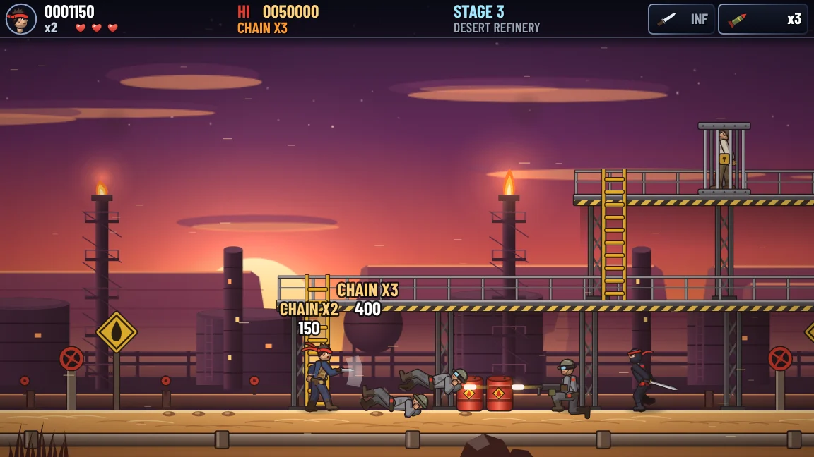
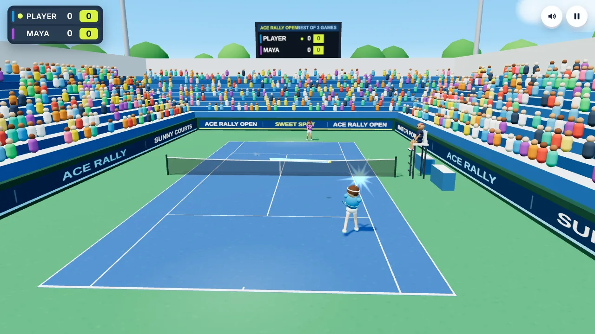
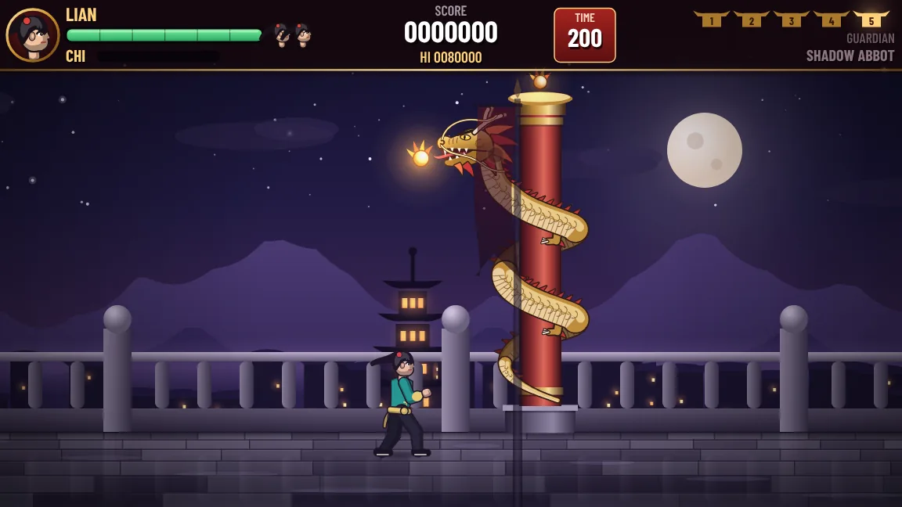

# Pocket Arcade

Three original arcade games that run in the browser on phones and computers. No install, no account.

**Play online:** https://pocket-arcade-rouge.vercel.app/

Direct links: [Dagger Raid](https://pocket-arcade-rouge.vercel.app/dagger-raid), [Ace Rally Tennis](https://pocket-arcade-rouge.vercel.app/tennis) and [Dragon Pagoda](https://pocket-arcade-rouge.vercel.app/dragon-pagoda)

| Dagger Raid | Ace Rally Tennis | Dragon Pagoda |
| --- | --- | --- |
| [](https://pocket-arcade-rouge.vercel.app/dagger-raid) | [](https://pocket-arcade-rouge.vercel.app/tennis) | [](https://pocket-arcade-rouge.vercel.app/dragon-pagoda) |
| Side-scrolling commando raid with a combat knife | Stadium tennis you can swing with your webcam | Kung fu climb through five guarded pagoda floors |

## Dagger Raid

A side-scrolling commando game in the classic arcade style, drawn in sharp vector art at any screen size.

- Four stages: Jungle Outpost, Frozen Rail Line, Desert Refinery and Iron Citadel, each with its own weather and music
- Four bosses: Mauler, Ironclad, Sky Hammer and General Krome
- Knife combos (stab, slash, thrust), crouch and jump attacks, parries that cut bullets out of the air, critical hits and backstabs
- Ninja movement: dash roll with a dodge window, counter strikes, double jump somersault, air dash, dive stab and wall kick
- Weapons: Katana (reflects shots), Tri-Knife, Shuriken, Grenade, Rocket and Flamethrower
- Enemy ninjas that vanish in smoke, throw shuriken and strike from behind
- Captives to free, crates, explosive barrels and mines
- Chain bonuses, extra lives at 30,000 points and every 70,000 after, continues and a top-5 high score table
- Four levels (Recruit, Soldier, Veteran, Elite) and an Invincible mode for a no-damage playthrough (scores and medals are off)
- 16 medals, stage select for stages you have reached, two unlockable outfits and Restart Stage in the pause menu

| Action | Keyboard | Gamepad | Touch |
| --- | --- | --- | --- |
| Move and climb | Arrow keys or WASD | Stick or D-pad | Pad |
| Knife | Z, J or F | X | B |
| Jump | X, K or Space | A | A |
| Special weapon | C or L | B or Y | C |
| Dash | V, Q or Shift | LB or RB | D |
| Pause | P, Esc or Enter | Start | II |

Down crouches. Down plus Jump drops through a walkway. Jump again in the air to somersault, press Down plus Knife in the air to dive, and double tap a direction to dash.

## Ace Rally Tennis

Bright stadium tennis with full tennis scoring. Your player runs to the ball on their own; you decide when to swing.

- Swing by raising a hand at the webcam, or play with the keyboard, mouse or touch screen
- Singles, Doubles and Practice modes
- Four opponents (Rookie, Pro, Champion and Legend), courts on Hard, Grass and Clay plus an unlockable Royal indoor court, and match lengths from one game to best of three sets
- Power shot: three perfectly timed swings in a row charge a faster shot that cannot miss
- Invincible rules: a point you would lose is replayed instead (wins do not count toward your record or medals)
- 12 medals to earn

Keyboard: Space, Enter or a click swings. Hold Left or Right while swinging to aim, Up for a lob, Down for a drop shot. P pauses, M mutes.

The webcam mode needs a secure page (HTTPS), which the live site provides. The browser asks for camera permission the first time.

## Dragon Pagoda

A kung fu climb in hand-drawn HD, inspired by 1980s arcade brawlers but with its own characters.

- Five floors: Lantern Hall, Drum Gallery, Iron Forge, Mirror Shrine and Dragon Summit, each with its own hazard
- Five guardians: Crimson Fan, Jade Spear, Iron Ox, Mirror Monk and Shadow Abbot
- Two fighters: Tao (heavy kicks) and Lian (double jump, faster chi)
- Three-hit combos with launching finishers, sweeps, jump attacks and dagger deflects
- Chi meter and the Dragon Wave super; mash to break free from grabs
- Ninja arts: dash with a dodge window, shadow strikes, flips, wall jumps and critical hits
- Weapons to pick up: nunchaku, bo staff and shuriken, plus enemy ninjas on the upper floors
- Four levels (Novice, Disciple, Master, Grandmaster) and an Invincible mode
- 10 medals, a quick start from any floor you have reached and Restart Floor in the pause menu
- Floor timer, tally bonuses, continues and a top-5 score table

| Action | Keyboard | Gamepad | Touch |
| --- | --- | --- | --- |
| Move and crouch | Arrow keys or WASD | Stick or D-pad | Pad |
| Punch | Z or J | X | P |
| Kick | X or K | B | K |
| Jump | Space or Up | A | J |
| Dragon Wave | C, L or Shift | Y, LB or RB | CHI |
| Dash | V or Q, or double tap a direction | LT or RT | Double tap the pad |
| Pause / mute | P or Esc / M | Start | II |

## Project layout

```
index.html            landing page
dagger-raid/          playable Dagger Raid (one self-contained HTML file)
tennis/               playable Ace Rally Tennis (one self-contained HTML file)
dragon-pagoda/        playable Dragon Pagoda (one self-contained HTML file)
assets/               screenshots for the landing page
favicon.svg           site icon
vercel.json           settings used when the repo is deployed on Vercel
source/               readable source for every game and the build scripts
```

Everything is static: no server code, no build step needed to host it. Art, music and sound effects are all generated in code at runtime.

## Run it locally

```
python3 -m http.server 8000
```

Then open http://localhost:8000.

## Hosting

The live site runs on Vercel at https://pocket-arcade-rouge.vercel.app/ and is connected to this repository, so every push to `main` publishes a new version automatically.

- **Vercel (another copy):** Add New Project, import this repository, keep the framework preset as Other, then Deploy.
- **GitHub Pages:** Settings, Pages, deploy from the `main` branch and the `/ (root)` folder.

## Changing a game

Edit the files under `source/`, then rebuild the playable pages:

```
python3 source/build_site.py
```

The script bundles each game's `src/` files into a single HTML page and copies it into `dagger-raid/`, `tennis/` and `dragon-pagoda/`.

## Credits

Ace Rally Tennis renders its 3D court with [three.js](https://threejs.org) (MIT License, see `source/ace-rally-tennis/vendor/package/LICENSE`). Fonts load from Google Fonts: Press Start 2P, Chakra Petch, Fredoka, M PLUS Rounded 1c, Barlow Condensed, Black Ops One, Cinzel and Ma Shan Zheng.
