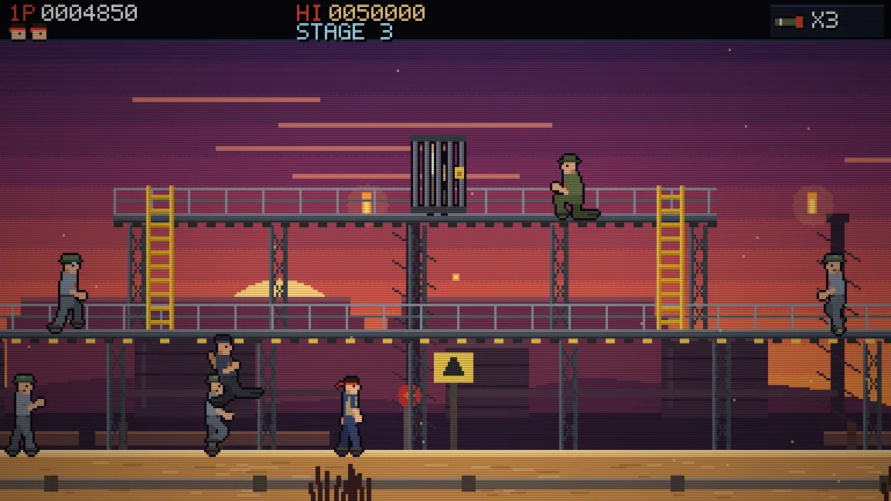
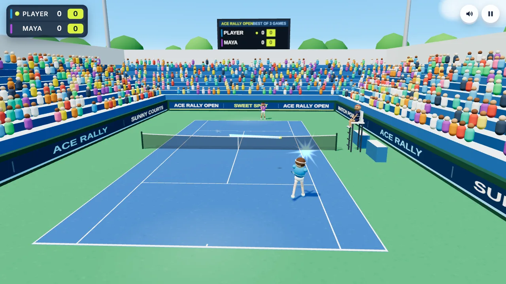

# Pocket Arcade

Two original arcade games that run in the browser on phones and computers. No install, no account.

**Play online:** https://pocket-arcade-rouge.vercel.app/

Direct links: [Dagger Raid](https://pocket-arcade-rouge.vercel.app/dagger-raid) and [Ace Rally Tennis](https://pocket-arcade-rouge.vercel.app/tennis)

| Dagger Raid | Ace Rally Tennis |
| --- | --- |
| [](https://pocket-arcade-rouge.vercel.app/dagger-raid) | [](https://pocket-arcade-rouge.vercel.app/tennis) |
| Side-scrolling commando raid with a combat knife | Stadium tennis you can swing with your webcam |

## Dagger Raid

A side-scrolling commando game in the classic arcade style.

- Four stages: Jungle Outpost, Frozen Rail Line, Desert Refinery and Iron Citadel, each with its own weather and music
- Four bosses: Mauler, Ironclad, Sky Hammer and General Krome
- Knife fighting while standing, crouching or jumping, plus knocking bullets out of the air
- Special weapons dropped by officers: Tri-Knife, Grenade and Rocket
- Captives to free, crates, explosive barrels and mines
- Chain bonuses, extra lives at 30,000 points and every 70,000 after, continues and a top-5 high score table
- Two rule sets: Arcade (one hit ends a life) and Modern (three hits per life)

| Action | Keyboard | Gamepad | Touch |
| --- | --- | --- | --- |
| Move and climb | Arrow keys or WASD | Stick or D-pad | Pad |
| Knife | Z, J or F | X | B |
| Jump | X, K or Space | A | A |
| Special weapon | C, L or Shift | B or Y | C |
| Pause | P, Esc or Enter | Start | II |

Down crouches. Down plus Jump drops through a walkway.

## Ace Rally Tennis

Bright stadium tennis with full tennis scoring. Your player runs to the ball on their own; you decide when to swing.

- Swing by raising a hand at the webcam, or play with the keyboard, mouse or touch screen
- Singles, Doubles and Practice modes
- Three opponents (Rookie, Pro and Champion), three courts (Hard, Grass and Clay) and match lengths from one game to best of three sets

Keyboard: Space, Enter or a click swings. Hold Left or Right while swinging to aim, Up for a lob, Down for a drop shot. P pauses, M mutes.

The webcam mode needs a secure page (HTTPS), which the live site provides. The browser asks for camera permission the first time.

## Project layout

```
index.html            landing page
dagger-raid/          playable Dagger Raid (one self-contained HTML file)
tennis/               playable Ace Rally Tennis (one self-contained HTML file)
assets/               screenshots for the landing page
favicon.svg           site icon
vercel.json           settings used when the repo is deployed on Vercel
source/               readable source for both games and the build scripts
```

Everything is static: no server code, no build step needed to host it. Art, music and sound effects are all generated in code at runtime.

## Run it locally

```
python3 -m http.server 8000
```

Then open http://localhost:8000.

## Hosting

The live site runs on Vercel at https://pocket-arcade-rouge.vercel.app/ and is connected to this repository, so every push to `main` publishes a new version automatically.

- **Vercel (another copy):** Add New Project, import this repository, keep the framework preset as Other, then Deploy.
- **GitHub Pages:** Settings, Pages, deploy from the `main` branch and the `/ (root)` folder.

## Changing a game

Edit the files under `source/`, then rebuild the playable pages:

```
python3 source/build_site.py
```

The script bundles each game's `src/` files into a single HTML page and copies it into `dagger-raid/` and `tennis/`.

## Credits

Ace Rally Tennis renders its 3D court with [three.js](https://threejs.org) (MIT License, see `source/ace-rally-tennis/vendor/package/LICENSE`). Fonts load from Google Fonts: Press Start 2P, Chakra Petch, Fredoka and M PLUS Rounded 1c.
