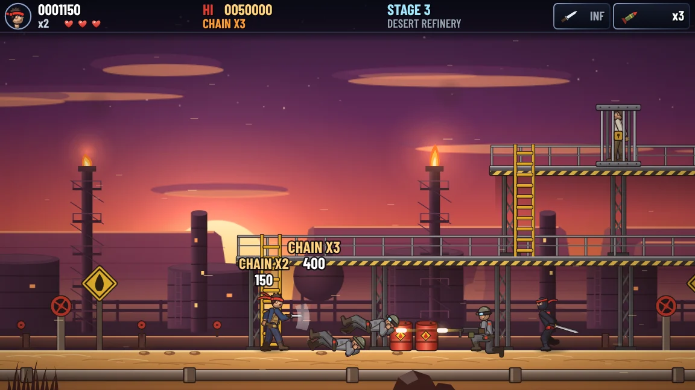
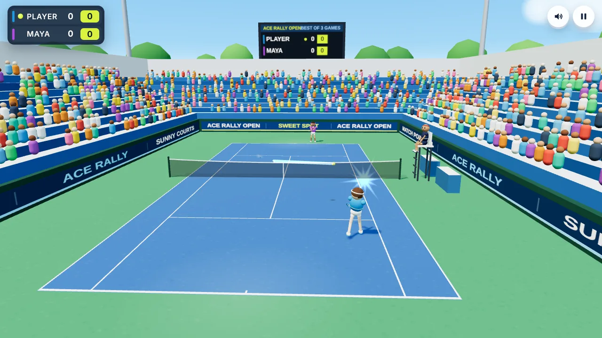
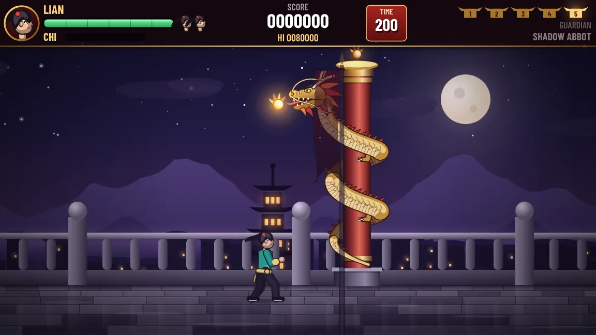
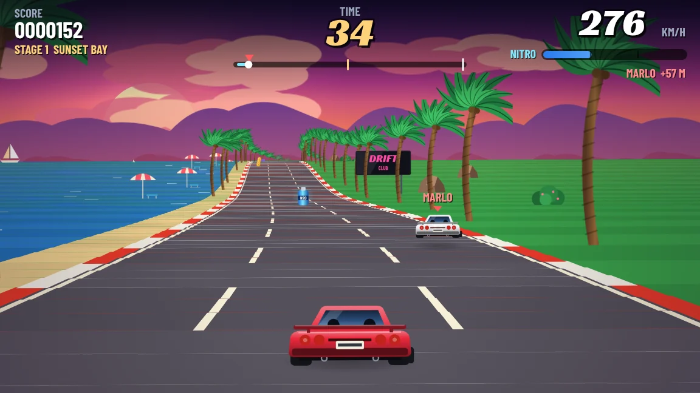
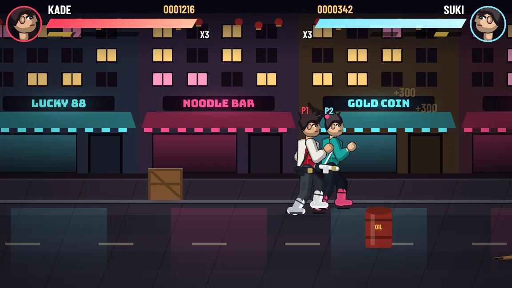
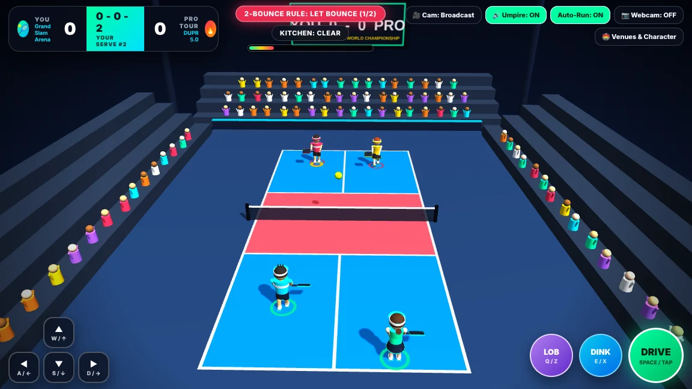

# Pocket Arcade

Six original games that run in the browser on phones and computers. No install, no account.

**Play online:** https://pocket-arcade-rouge.vercel.app/

Direct links: [Dagger Raid](https://pocket-arcade-rouge.vercel.app/dagger-raid), [Ace Rally Tennis](https://pocket-arcade-rouge.vercel.app/tennis), [Dragon Pagoda](https://pocket-arcade-rouge.vercel.app/dragon-pagoda), [Redline Coast](https://pocket-arcade-rouge.vercel.app/redline-coast) [Iron Alley](https://pocket-arcade-rouge.vercel.app/iron-alley) and [Pickleball Tour Pro 3D](https://pocket-arcade-rouge.vercel.app/pickleball)

| Dagger Raid | Ace Rally Tennis | Dragon Pagoda | Redline Coast | Iron Alley | Pickleball Tour Pro 3D |
| --- | --- | --- | --- | --- | --- |
| [](https://pocket-arcade-rouge.vercel.app/dagger-raid) | [](https://pocket-arcade-rouge.vercel.app/tennis) | [](https://pocket-arcade-rouge.vercel.app/dragon-pagoda) | [](https://pocket-arcade-rouge.vercel.app/redline-coast) | [](https://pocket-arcade-rouge.vercel.app/iron-alley) | [](https://pocket-arcade-rouge.vercel.app/pickleball) |
| Side-scrolling commando raid with a combat knife | Stadium tennis you can swing with your webcam | Kung fu climb through five guarded pagoda floors | Open-road racer against the clock and a rival | Two-player street brawler through four districts | 3D doubles or singles across four world venues |

## Dagger Raid

A side-scrolling commando game in the classic arcade style, drawn in sharp vector art at any screen size.

- Four stages: Jungle Outpost, Frozen Rail Line, Desert Refinery and Iron Citadel, each with its own weather and music
- Four bosses: Mauler, Ironclad, Sky Hammer and General Krome
- You play a beret soldier who builds a team of three: each captive you free picks up a rifle, the first taking point ahead of you and the second covering behind
- Every stage fields its own army in its own uniform: rust guerrillas with machetes and dogs in the jungle, winter riflemen, snipers and paratroopers on the rail line, tan flame troopers at the refinery, black-clad guards and ninjas in the citadel
- An air raid siren winds up at the start of a stage, before big enemy waves and when a boss approaches
- Knife combos (stab, slash, thrust), crouch and jump attacks, parries that cut bullets out of the air, critical hits and backstabs
- Ninja movement: dash roll with a dodge window, counter strikes, double jump somersault, air dash, dive stab and wall kick
- Weapons: Katana (reflects shots), Tri-Knife, Shuriken, Grenade, Rocket and Flamethrower
- Enemy ninjas that vanish in smoke, throw shuriken and strike from behind
- Captives to free, crates, explosive barrels and mines
- Chain bonuses, extra lives at 30,000 points and every 70,000 after, continues and a top-5 high score table
- Four levels (Recruit, Soldier, Veteran, Elite) and an Invincible mode for a no-damage playthrough (scores and medals are off)
- 19 medals, stage select for stages you have reached, two unlockable outfits and Restart Stage in the pause menu
- Upgrade cards: pick one of three power-ups before every stage (12 in all), so each run plays differently
- Style rank from D to S that multiplies chain scores, with a camera push-in on critical hits and finishing blows
- A war-zone film score: marching snare cadence, war drums, urgent low strings, horns and a distant choir, with field gunfire, rolling blasts and far-off battle ambience

| Action | Keyboard | Gamepad | Touch |
| --- | --- | --- | --- |
| Move and climb | Arrow keys or WASD | Stick or D-pad | Pad |
| Knife | Z, J or F | X | B |
| Jump | X, K or Space | A | A |
| Special weapon | C or L | B or Y | C |
| Dash | V, Q or Shift | LB or RB | D |
| Pause | P, Esc or Enter | Start | II |

Down crouches. Down plus Jump drops through a walkway. Jump again in the air to somersault, press Down plus Knife in the air to dive, and double tap a direction to dash.

## Ace Rally Tennis

Bright stadium tennis with full tennis scoring. Your player runs to the ball on their own; you decide when to swing.

- Swing by raising a hand at the webcam, or play with the keyboard, mouse or touch screen
- Singles, Doubles and Practice modes
- Four opponents (Rookie, Pro, Champion and Legend), courts on Hard, Grass and Clay plus an unlockable Royal indoor court, and match lengths from one game to best of three sets
- Power shot: three perfectly timed swings in a row charge a faster shot that cannot miss
- Invincible rules: a point you would lose is replayed instead (wins do not count toward your record or medals)
- 14 medals to earn
- Career: three cups and nine matches against rising opponents, with skill points to spend on Power, Speed and Control

Keyboard: Space, Enter or a click swings. Hold Left or Right while swinging to aim, Up for a lob, Down for a drop shot. P pauses, M mutes.

The webcam mode needs a secure page (HTTPS), which the live site provides. The browser asks for camera permission the first time.

## Dragon Pagoda

A kung fu climb in hand-drawn HD, inspired by 1980s arcade brawlers but with its own characters.

- Five floors: Lantern Hall, Drum Gallery, Iron Forge, Mirror Shrine and Dragon Summit, each with its own hazard
- Five guardians: Crimson Fan, Jade Spear, Iron Ox, Mirror Monk and Shadow Abbot
- Two fighters: Tao (heavy kicks) and Lian (double jump, faster chi)
- Three-hit combos with launching finishers, sweeps, jump attacks and dagger deflects
- Chi meter and the Dragon Wave super; mash to break free from grabs
- Ninja arts: dash with a dodge window, shadow strikes, flips, wall jumps and critical hits
- Weapons to pick up: nunchaku, bo staff and shuriken, plus enemy ninjas on the upper floors
- Four levels (Novice, Disciple, Master, Grandmaster) and an Invincible mode
- 10 medals, a quick start from any floor you have reached and Restart Floor in the pause menu
- Upgrade cards before every floor (8 in all) and a style rank from D to S
- Its own temple sound: plucked strings, bamboo flute, taiko, woodblock and gong in pentatonic modes
- Floor timer, tally bonuses, continues and a top-5 score table

| Action | Keyboard | Gamepad | Touch |
| --- | --- | --- | --- |
| Move and crouch | Arrow keys or WASD | Stick or D-pad | Pad |
| Punch | Z or J | X | P |
| Kick | X or K | B | K |
| Jump | Space or Up | A | J |
| Dragon Wave | C, L or Shift | Y, LB or RB | CHI |
| Dash | V or Q, or double tap a direction | LT or RT | Double tap the pad |
| Pause / mute | P or Esc / M | Start | II |

## Redline Coast

An open-road racer drawn the classic arcade way (scaled sprites on a segmented road), inspired by the great 1980s driving cabinets but with its own cars, stages and soundtrack.

- Five stages: Sunset Bay, Mesa Run, Pine Pass, Neon Harbor and Aurora Ridge, each with its own scenery, weather and hazards
- Race the clock: reach the checkpoint and the goal before time runs out; spare seconds become score
- A race on every stage: you start 8th behind a pack led by a named rival (Marlo, Dusty, Frost, Nova, Zenith) and score by finishing place
- Tunnels, jump ramps, boost pads and police chases that you can outrun or dodge
- On a phone held upright the race fills the whole screen; slide your thumb along the steering bar for smooth, analog steering, with brake and nitro on the right
- Rocket start: hit nitro as the lights say GO
- Drift (tap brake while turning) for a boost, nitro, slipstream, and near-miss chains that multiply the score
- Three cars with different speed, acceleration and grip; four levels from Cruise to Legend
- Pick-ups, twelve medals, high scores, and a touch pad with automatic gas on phones
- Keys: arrows steer and accelerate, Z brakes, Space fires nitro, P pauses, M mutes

## Iron Alley

An original two-player street brawler: own characters, gang, districts and soundtrack. Brick tenements with lit windows, drainpipes, grime and graffiti line the streets; fighters walk in a guarded stance with a weighted stride.

- Two heroes: Kade (heavy hands) and Suki (fast feet); player two can join at any time
- Four districts: Neon Market, Freight Yard, Steel Foundry and Viper Tower, each ending in a boss (Tank, Ratchet, Forge, The Warden)
- Classic belt-scroller fighting with weight: jab, jab, hook; side kick and roundhouse; the back elbow; flying kick; a jumping spin kick on a short recharge
- Two quick hits double an enemy over. Punch him again to grab his head: two punches are knees, the third (or a kick) lifts him over your head and slams him down behind you
- Weapons swing on punch; kicks still work with a bat or pipe in your hand
- Punks pin your arms from behind while a partner hits you; mash any button to break free
- Knock weapons loose and take them (bats, pipes, knives), lift and throw oil drums, and throw the gang into pits (but do not fall in yourself)
- Four levels from Easy to Brutal, lives and continues, twelve medals, high scores with initials
- Keys: player one arrows, Z punch, X kick, C jump, V spin kick; player two W A S D, F punch, G kick, H jump, T spin kick; P pauses, M mutes

## Phones, tablets and computers

All five games are built for current Safari on iPhone and iPad, Chrome on Android, and Chrome, Edge, Safari or Firefox on Windows and Mac. On a phone, hold it sideways for the biggest picture; held upright, Dagger Raid, Dragon Pagoda and Redline Coast zoom in and follow your fighter so the picture stays large. The pages lock the zoom level and re-measure the screen after every rotation, so a stray double tap or pinch should not leave you looking at oversized buttons.

## Project layout

```
index.html            landing page
dagger-raid/          playable Dagger Raid (one self-contained HTML file)
tennis/               playable Ace Rally Tennis (one self-contained HTML file)
dragon-pagoda/        playable Dragon Pagoda (one self-contained HTML file)
redline-coast/        playable Redline Coast (one self-contained HTML file)
iron-alley/           playable Iron Alley (one self-contained HTML file)
assets/               screenshots for the landing page
favicon.svg           site icon
vercel.json           settings used when the repo is deployed on Vercel
source/               readable source for every game and the build scripts
```

Everything is static: no server code, no build step needed to host it. Art, music and sound effects are all generated in code at runtime.

## Run it locally

```
python3 -m http.server 8000
```

Then open http://localhost:8000.

## Hosting

The live site runs on Vercel at https://pocket-arcade-rouge.vercel.app/ and is connected to this repository, so every push to `main` publishes a new version automatically.

- **Vercel (another copy):** Add New Project, import this repository, keep the framework preset as Other, then Deploy.
- **GitHub Pages:** Settings, Pages, deploy from the `main` branch and the `/ (root)` folder.

## Changing a game

Edit the files under `source/`, then rebuild the playable pages:

```
python3 source/build_site.py
```

The script bundles each game's `src/` files into a single HTML page and copies it into `dagger-raid/`, `tennis/`, `dragon-pagoda/`, `redline-coast/` and `iron-alley/`.

## Credits

Ace Rally Tennis renders its 3D court with [three.js](https://threejs.org) (MIT License, see `source/ace-rally-tennis/vendor/package/LICENSE`). Dagger Raid and Dragon Pagoda mix recorded blade, footstep, metal, cloth and impact clips from Kenney's RPG Audio pack (CC0, kenney.nl) with sound synthesized in code. Fonts load from Google Fonts: Press Start 2P, Chakra Petch, Fredoka, M PLUS Rounded 1c, Barlow Condensed, Black Ops One, Cinzel and Ma Shan Zheng.

## Pickleball Tour Pro 3D

Play at `/pickleball/`. Championship pickleball in 3D (three.js r128), imported from the
[Pickleball-Tour-Pro](https://github.com/nadeemkhawaja/Pickleball-Tour-Pro) repository and kept as written.

- Doubles or singles against an AI tour rated 3.5 Club, 4.5 Pro or 5.5+ Master
- Four venues: Grand Slam Arena, Sunset City Rooftop, Emerald Central Park and Malibu Beach Club
- Female or male pro, three outfit colourways, a live umpire calling the kitchen and the two-bounce rule
- Optional webcam swing: raise your hand in the green box
- Controls: W A S D or arrows move, Space drive, E or X dink, Q or Z lob, Shift Erne; on a phone, the touch pad and the LOB, DINK and DRIVE buttons

Source: `source/pickleball-tour-pro/src/index.html`. Its build inlines three.js r128
(MIT licence, `source/pickleball-tour-pro/vendor/LICENSE-three.txt`) in place of the CDN link, so the page needs no outside requests.
